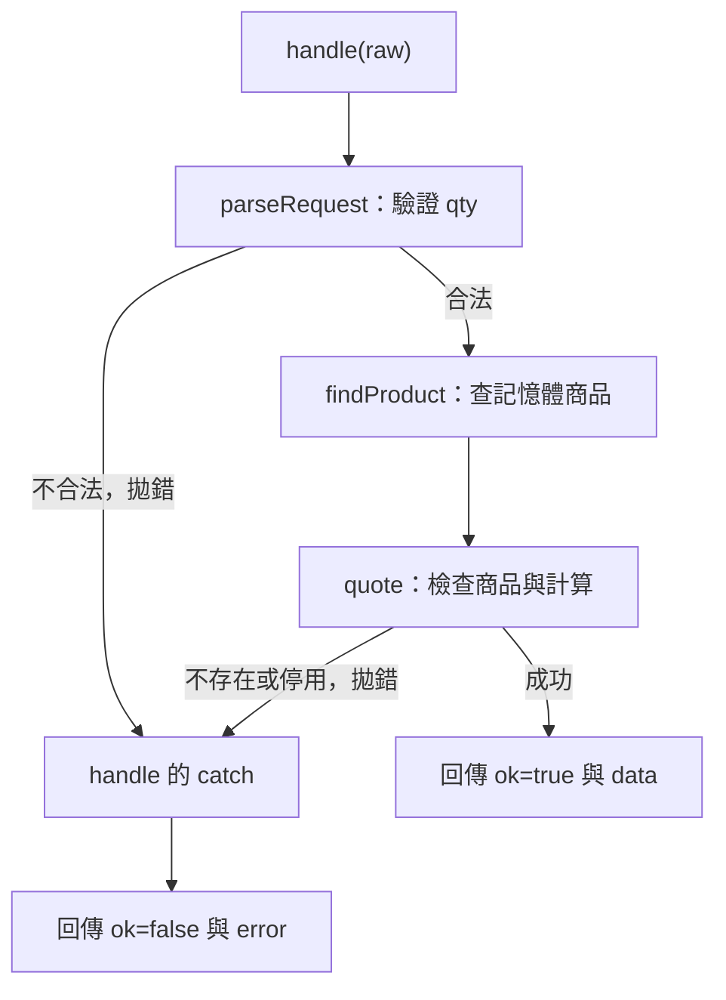

# 第 25 課｜讓 AI 幫你讀懂陌生程式

日期：2026-11-04（Asia/Taipei）  
時間：約 30 分鐘  
程度：有使用經驗的中低階使用者  
主題：從入口、資料流到可驗證的解釋。

上一課用最小案例驗證修正；今天先退一步，練習在修改之前理解程式。好的說明應指出資料經過哪些函式、在哪裡被檢查、錯誤如何返回，而不只是逐行翻譯語法。

## 學習目標與時間安排

| 時間 | 活動 | 驗收 |
| --- | --- | --- |
| 0–5 分鐘 | 找到入口與輸出 | 說出一次呼叫的起點與結果 |
| 5–10 分鐘 | 區分函式責任 | 找到數量驗證與商品狀態檢查 |
| 10–18 分鐘 | 跟做程式與提示詞 | 產出正常及失敗路徑 |
| 18–23 分鐘 | 核對執行軌跡 | 三個案例與解釋一致 |
| 23–28 分鐘 | 立即練習 | 預測新輸入會走哪條路 |
| 28–30 分鐘 | 回顧 | 分開程式事實、推論及未知 |

完成後，你應能讓 AI 提供「可對照程式的說明」，並知道還需閱讀哪些實際檔案，才有足夠依據進行修改。

## 一、先問一條流程，不必一開始讀完整專案

官方 Prompting 文件建議從相關程式與請求流程切入，要求說明模組責任、資料驗證位置與修改注意事項，並用步驟或圖表核對。[官方文件：Explain a codebase](https://learn.chatgpt.com/docs/prompting)

可以把「解釋整個專案」縮成：

> 使用者送出商品代號與數量後，如何得到報價？錯誤在哪裡被擋下？

這樣比較容易界定需要讀取的入口、相依函式與測試。官方「Understand large codebases」案例同樣強調追蹤資料流、責任分工與副作用，再指出下一步值得閱讀的檔案。[官方案例](https://learn.chatgpt.com/use-cases/codebase-onboarding)

### 四個閱讀問題

1. **入口是誰？** 從哪個函式、事件或路由開始？
2. **資料怎麼變？** 原始輸入如何轉成內部資料，再變成結果？
3. **哪裡分支？** 哪些條件提早中止或改變路徑？
4. **有什麼副作用？** 是否寫檔、改狀態、寄信、呼叫服務？

函式名稱只是線索。叫 findProduct 不代表一定查資料庫；叫 handle 也不代表一定是 HTTP handler。必須看實作和呼叫位置。

## 二、完整 Demo：從輸入到報價

### 情境與範例資料

以下是自製、單檔、同步的 JavaScript 範例。商品 P1 單價 120 且啟用；P2 單價 80 但停用。價格是教學數字，沒有幣別、稅金或折扣規則。

呼叫 handle({sku:"P1", qty:2})，預期取得總額 240。這段程式不建立訂單、不扣款、不查庫存，也不連接外部服務。

### 完整可執行程式

存成 lesson25-demo.js，於已安裝 Node.js 的電腦執行：
`node .\lesson25-demo.js`。
也可在空白瀏覽器頁面的開發者工具 Console 執行。沒有執行環境時可手動追蹤，但要註記未實測。

```javascript
// 教學用記憶體資料；沒有資料庫、網路或付款。
const catalog = {P1: {price: 120, active: true}, P2: {price: 80, active: false}};
function parseRequest(raw, trace) {
 trace.push("parseRequest");
 if (!raw || !Number.isInteger(raw.qty) || raw.qty < 1)
   throw new Error("INVALID_QTY");
 return {sku: raw.sku, qty: raw.qty};
}
function findProduct(sku, trace) {
 trace.push("findProduct");
 return Object.prototype.hasOwnProperty.call(catalog, sku) ? catalog[sku] : null;
}
function quote(item, product, trace) {
 trace.push("quote");
 if (!product || !product.active) throw new Error("UNAVAILABLE");
 return {sku:item.sku, qty:item.qty, total:product.price * item.qty};
}
function handle(raw) {
 const trace = [];
 try {
   const item = parseRequest(raw, trace);
   const product = findProduct(item.sku, trace);
   return {ok:true, data:quote(item, product, trace), trace};
 } catch (error) {
   return {ok:false, error:error.message, trace};
 }
}
const cases = [
 [{sku:"P1",qty:2}, {ok:true,data:{sku:"P1",qty:2,total:240},
   trace:["parseRequest","findProduct","quote"]}],
 [{sku:"P1",qty:0}, {ok:false,error:"INVALID_QTY",trace:["parseRequest"]}],
 [{sku:"P2",qty:1}, {ok:false,error:"UNAVAILABLE",
   trace:["parseRequest","findProduct","quote"]}]
];
for (const [input, expected] of cases) {
 const actual = handle(input);
 if (JSON.stringify(actual) !== JSON.stringify(expected)) throw new Error("MISMATCH");
 console.log(JSON.stringify(actual));
}
console.log("PASS: 3 results and call traces");
```

### 可複製提示詞

先只貼上述程式，不貼後面的參考解釋，練習檢查模型是否能自行追蹤。

```text
請解釋下面程式的報價流程，讀者有基本 JavaScript 經驗。
本次先理解，不修改程式。

請提供：
1. 入口、主要函式責任與輸出格式。
2. 使用 {sku:"P1", qty:2} 追蹤每一步的資料。
3. qty=0 與停用商品 P2 分別在哪裡停止或報錯。
4. 哪些驗證已存在，哪些未看到。
5. 副作用與外部相依：只根據實作判斷。
6. 以函式名稱定位每個主要說法；沒有行號就不要捏造。
7. 三個能核對解釋的測試，以及下一步應閱讀的內容。

區分「由程式直接可知」「依命名推測」「未提供資訊」。
若沒有實際執行，不要聲稱測試通過。
程式：
（貼上本課完整程式）
```

### 操作步驟

1. 找到 handle；它是本次分析的入口，測試迴圈只是呼叫它的示範。
2. 使用提示詞取得說明，先核對函式責任，不急著接受架構名詞。
3. 手動計算 P1、qty=2 的結果，寫下預測呼叫順序。
4. 執行程式，對照三個結果與 trace。
5. 找出 AI 說明裡的額外假設，例如「已檢查庫存」「保存訂單」，逐一要求證據。
6. 依下方參考解釋驗收，保留仍未證明的問題。

## 三、參考解釋：對照資料與分支

以下為本課整理的解釋，並非另一個模型回覆的測試結果。

| 函式 | 責任 | 重要限制 |
| --- | --- | --- |
| handle | 建立 trace、協調流程、捕捉錯誤並回傳結果 | 不是完整 HTTP 伺服器 |
| parseRequest | 檢查 qty 是至少 1 的整數，選取 sku、qty | 沒有完整驗證 sku 型別或數量上限 |
| findProduct | 從記憶體 catalog 查商品 | 沒有資料庫 I/O |
| quote | 確認商品存在且啟用，計算單價乘數量 | 沒有折扣、稅金與庫存邏輯 |

### 正常路徑的資料變化

| 階段 | 資料或結果 |
| --- | --- |
| 輸入 handle | {sku:"P1", qty:2} |
| parseRequest 回傳 | {sku:"P1", qty:2}，新建的物件 |
| findProduct 回傳 | catalog 中 P1 的商品物件，price=120、active=true |
| quote 回傳 | {sku:"P1", qty:2, total:240} |
| handle 回傳 | ok=true、data 與三段 trace |



圖中箭頭描述呼叫與控制流程，不表示新執行緒或網路請求。Markdown 閱讀器若不支援 Mermaid，可以直接使用上下表格核對。

### 失敗路徑不能略過

- qty=0：parseRequest 拋錯，findProduct 與 quote 都不會執行。
- P2、qty=1：數量合法，因此會查到 P2；quote 才發現 active=false 並拋錯。
- 錯誤不是由各函式直接回傳 ok=false；是先拋出 Error，再由 handle 的 catch 轉成結果物件。

副作用方面，trace.push 會修改這次呼叫建立的陣列，示範測試會輸出 console 訊息。不能說整段程式「完全沒有副作用」，但也不能憑名稱捏造外部寫入。catalog 在這段執行流程中沒有被修改。

## 四、本次實際驗證結果

上述程式已在本次 JavaScript 執行環境中實際執行，三個案例均比對完整結果與 trace：

```text
{"ok":true,"data":{"sku":"P1","qty":2,"total":240},"trace":["parseRequest","findProduct","quote"]}
{"ok":false,"error":"INVALID_QTY","trace":["parseRequest"]}
{"ok":false,"error":"UNAVAILABLE","trace":["parseRequest","findProduct","quote"]}
PASS: 3 results and call traces
```

這能支持三組輸入的結果與記錄順序，不能證明所有輸入安全，也沒有驗證真實 UI、API 或模型解釋的正確率。

trace 是手動放置的標記：它能輔助核對，但若標記放錯位置，也會誤導。因此仍要讀呼叫處及拋錯位置，不能只相信紀錄文字。

## 五、把方法用到真實專案

先提供實際入口、最近的呼叫者與被呼叫函式，再請 AI 沿流程補讀必要檔案。如果使用 shell，可先用下列搜尋定位；這是操作建議，本次未在真實專案執行：

```powershell
rg -n "handle|parseRequest|findProduct|quote" .
```

下一步通常要找入口的路由或 UI 呼叫者、資料存取實作、設定與相關測試。這是「要尋找的類別」，不是宣稱你的專案一定有 routes.js、database.js 等檔案。

在非程式工作中，也可以用同樣方式讀一份報表流程：輸入檔案從哪裡來、在哪一步清理、哪裡計算、何時輸出。不要只逐欄翻譯名稱，要追蹤一筆資料。

## 六、最佳實踐與常見錯誤

| 建議 | 常見錯誤 |
| --- | --- |
| 指定一條使用者流程 | 讓 AI 泛談整個架構卻沒有證據 |
| 正常與失敗路徑一起讀 | 只說成功結果 |
| 用函式及實際檔案定位 | 捏造不存在的路徑或行號 |
| 區分讀碼與執行證據 | 看過程式就說測試通過 |
| 指出未提供的相依資訊 | 自動補出資料庫、快取或授權機制 |
| 先理解，再決定修改 | 還沒確認行為就大幅重構 |

## 七、立即練習：兩種新輸入

在原程式案例迴圈之後，分別呼叫：

```javascript
console.log(handle({sku:"NO_SUCH_PRODUCT", qty:1}));
console.log(handle({sku:"P1", qty:"2"}));
```

先寫下預期，再執行核對。

### 自我檢查標準

- 不存在的商品：經 parseRequest、findProduct、quote，最後 UNAVAILABLE。
- 字串 "2"：不是整數型別，停在 parseRequest，回傳 INVALID_QTY。
- 不把「看起來像數字」當成程式已自動轉型。
- 不存在商品與停用商品都回 UNAVAILABLE，但原因不同。
- 說明限制：sku 尚無完整型別驗證，不能據這兩題宣稱所有輸入皆安全。

這兩個練習變體未在本次製作流程中執行；上述為預期標準。

## 八、回顧與下堂預告

讀陌生程式時，從入口追蹤一筆資料，找到驗證、分支、輸出與副作用，再用少量代表性案例核對解釋。看懂不代表需要立即修改；不確定的部分應列為下一步閱讀或驗證事項。

下一課：**修改前先看影響範圍：呼叫者、契約與回歸檢查**。我們會用今天的報價流程，判斷一項小需求可能影響哪些位置。

## 官方來源與驗證範圍

查閱日期：2026-11-04。

- [ChatGPT Learn：Prompting](https://learn.chatgpt.com/docs/prompting) — Explain a codebase：流程、責任、驗證與可核對的說明。
- [ChatGPT Learn：Understand large codebases](https://learn.chatgpt.com/use-cases/codebase-onboarding) — 以具體功能追蹤資料流，找出修改前需閱讀的內容。

程式、商品資料、流程圖與練習為自製。原始三個案例的結果與 trace 已實測；未呼叫模型評估提示詞、未連接外部系統、未測試練習變體。教材以 UTF-8 Markdown 保存。

